# Zenelo

A music player for Android, made for the FiiO JM21 (a 4.7″ Android 13 player) but at home on any phone: your
own files first, and your [mStream](mStream/README.md) server's library beside them, in one library.

Dark, mustard and celadon, IBM Plex; built with Kotlin, Jetpack Compose and Media3.

<p>
  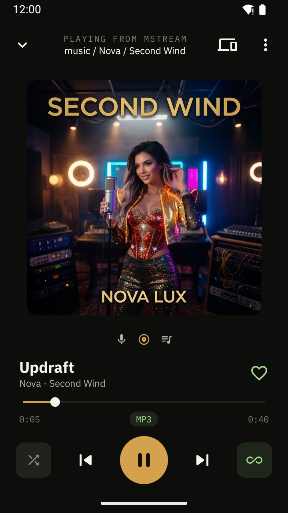
  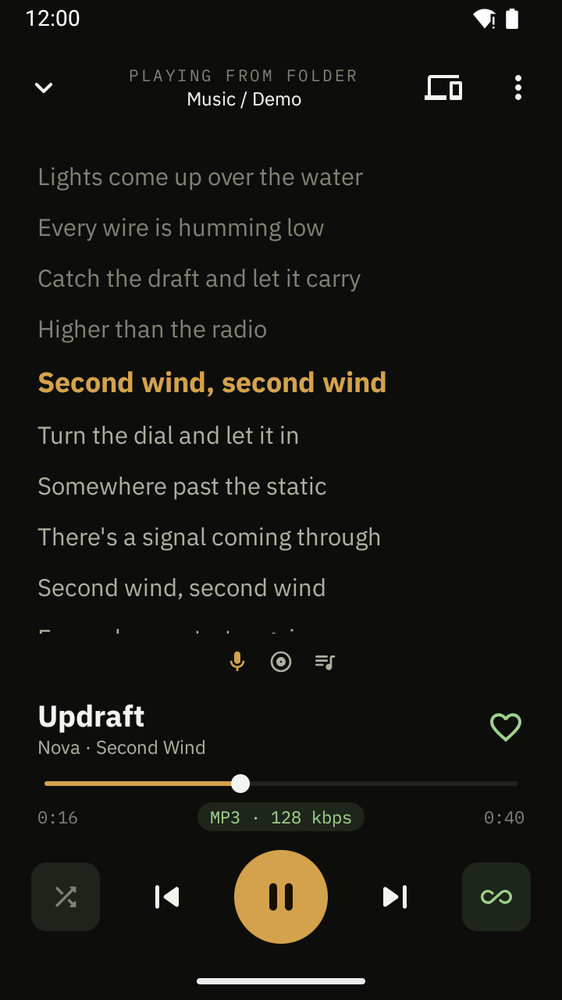
  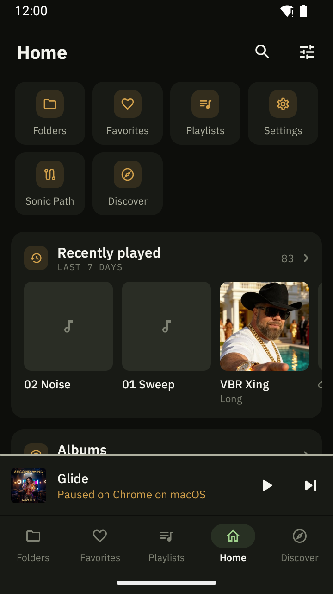
</p>

## Playing

- **The common formats**: MP3, FLAC, AAC / M4A, Opus, Vorbis, WAV (APE, WavPack and DSD through FFmpeg are
  planned). Gapless; exact seeking even in VBR MP3s without a seek table.
- **Loudness normalization.** ReplayGain tags when the files have them, otherwise each track is measured
  (EBU R128) in the background; track or album mode, a pre-amp, and never louder than the peak allows.
- **A fade at the end of a track** (or straight, gapless changes).
- **Now Playing** swipes between the cover, synced lyrics and the queue. Lyrics come from a `.lrc` beside the
  file, the tags or LRCLIB; covers from the file, its folder, or Deezer / iTunes / MusicBrainz / Last.fm.
- **The queue** is yours to edit: drag, swipe, select; shuffle by tracks, by albums, or "smart" (artists spread
  out, recently played last). It survives restarts.
- **A visualizer**: Milkdrop presets (butterchurn) driven by what plays.

<p>
  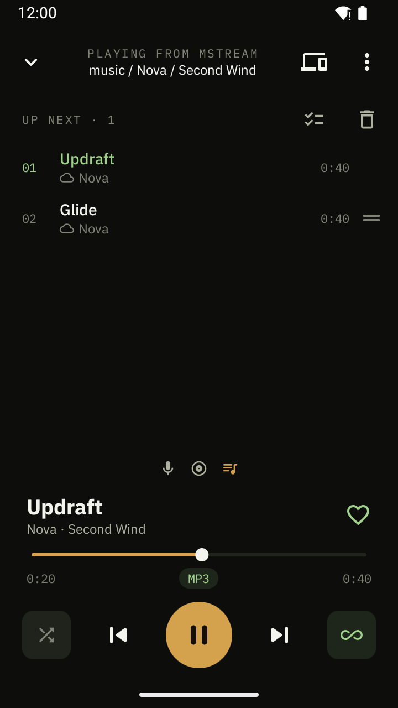
  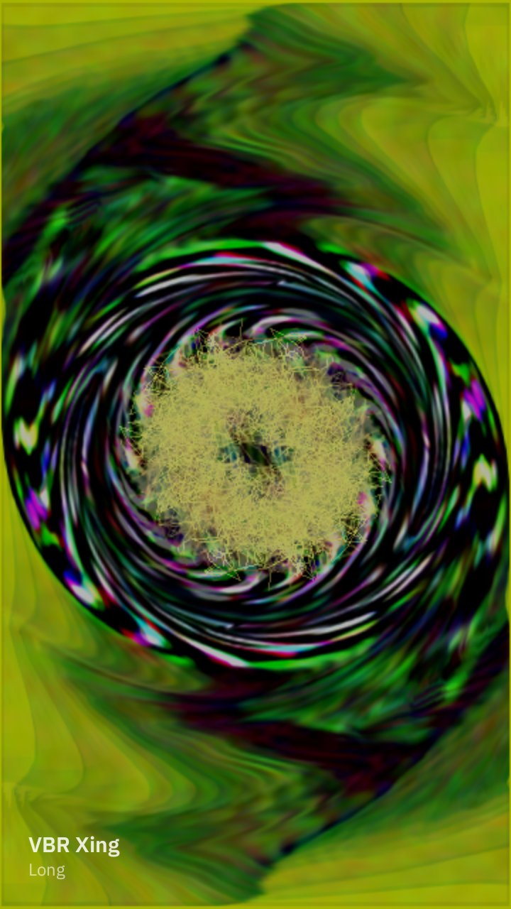
  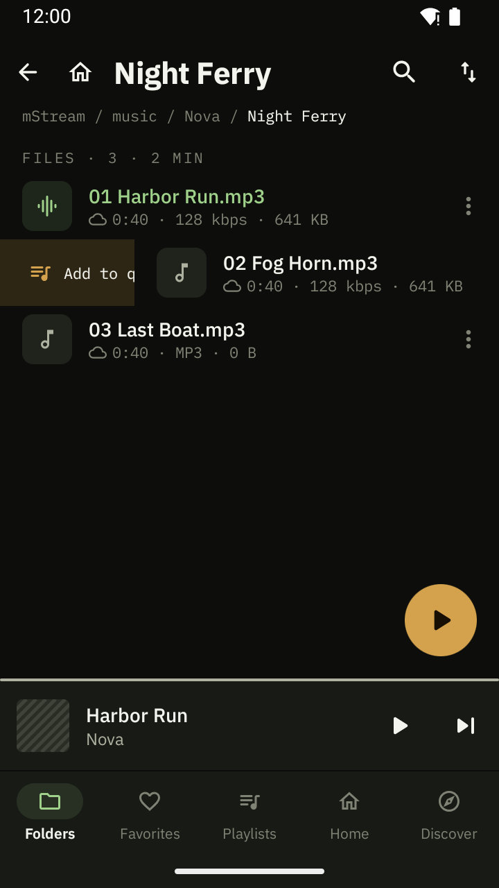
</p>

## Your library

- **Folders and a library.** Browse storage as folders, or by albums, artists, genres and all tracks, sorted any
  way, with an A–Z rail; Favorites, playlists (M3U import and export), Recently played, search, hidden tracks.
- **Home and the tab bar are yours to arrange**: which sections, in what order, as icons, a grid or a list.
- **Swipes on every row**: four configurable actions per row (short and long, both ways) — queue, play next,
  favorite, add to a playlist, download, hide, edit tags…
- **A tag editor**: title, artist, album, album artist, number, year, genre and the cover (from the file name
  patterns you set, or found online), written into the file.
- **Backup** of settings, favorites, playlists and plays into one file.

<p>
  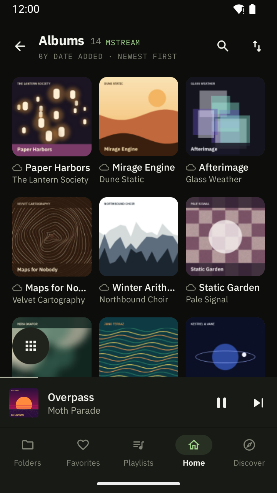
  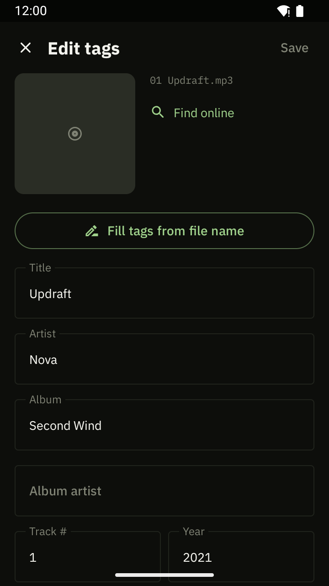
  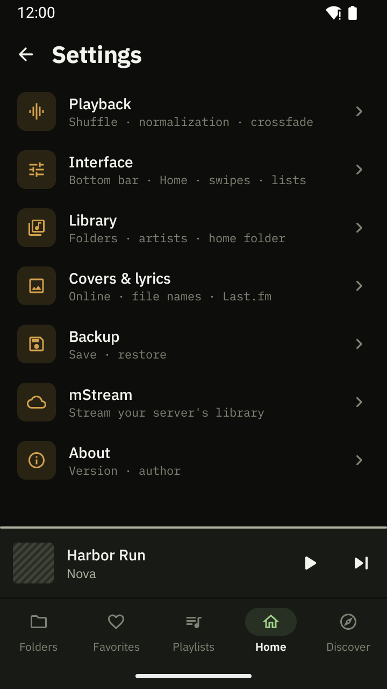
</p>

## With an mStream server

Zenelo is also a client for [the Zenelo fork of mStream](mStream/README.md), a self-hosted music server.
Sign in (a password, or single sign-on) and the server's library joins yours:

- **One library.** Server tracks sit beside local ones (a cloud mark); a file you have on both counts once. Pick
  All, Local or the server's from the title.
- **Streaming and downloads.** Stream the originals or transcodes; download songs, albums, playlists or
  Favorites to keep them; the next tracks of the queue are cached as you play. Offline, what can't play steps aside.
- **Two-way sync**: favorites ↔ ratings, playlists, plays and Recently played.
- **The server's ear**: Auto DJ (it keeps the queue going), Play similar, Sonic Path (from one sound to another),
  and Discover — more like what plays, from your library, your federated peers and the discovery network.
- **Devices**, Spotify Connect–style: see what plays on the server's other devices (the web player, the server's
  speakers), move playback between them, control them, and invite guests with a link or a QR code.
- **Federated peers**: browse the servers yours is paired with, play their music, and add it to your library.
- **Tags** of the server's files edited from the phone, when the server allows it.

Upstream [mStream](https://github.com/IrosTheBeggar/mStream) works too (a recent 6.x, with the library sync
manifest): everything above except devices and guests, editing the server's tags and single sign-on, which are the
fork's.

<p>
  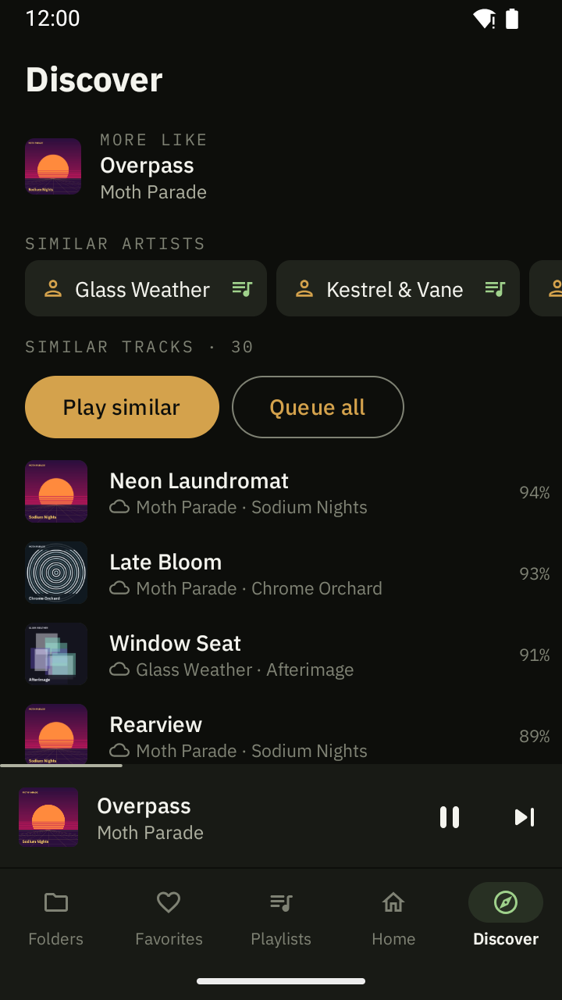
  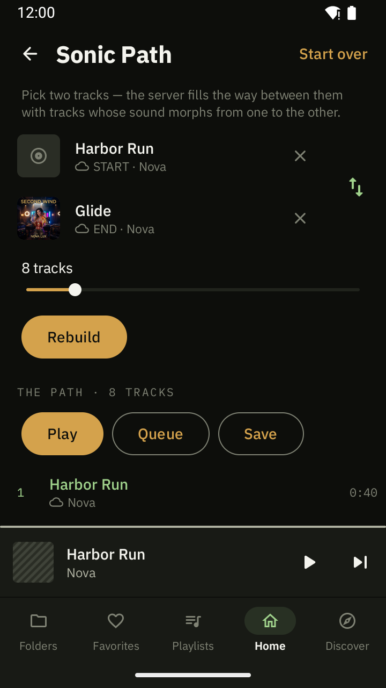
  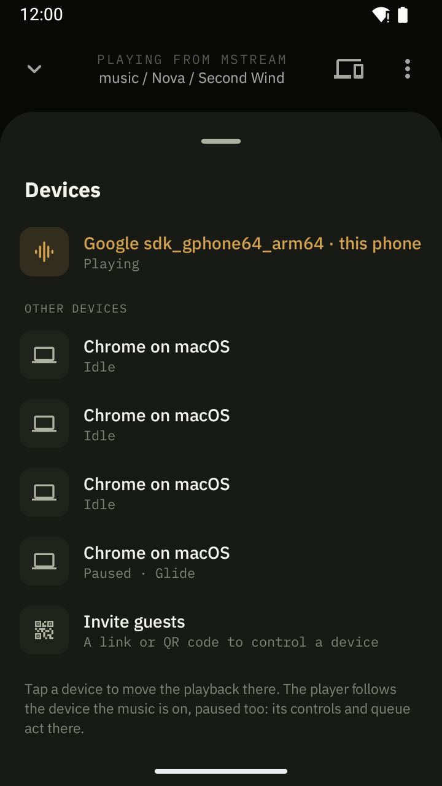
</p>

## Install

Download the APK from [Releases](https://github.com/ewoxej/zenelo/releases) and install it (Zenelo isn't on Google
Play). On first start it asks for access to all files: the folder browser reads storage directly.

## Build

Android SDK and JDK 17:

```sh
JAVA_HOME=/path/to/jdk-17 ./gradlew assembleDebug
```

The APK is `app/build/outputs/apk/debug/app-debug.apk`. `assembleRelease` gives the optimized build (signed with
the debug key unless `ZENELO_KEYSTORE*` are set); add `-PappIdSuffix=.debug` to install it as "Zenelo test"
beside the real app. The version is the `VERSION` file.

The mStream fork is a submodule: clone with `--recurse-submodules`, or run `git submodule update --init`.

## Credits

Built on [Media3 / ExoPlayer](https://github.com/androidx/media), [jaudiotagger](https://bitbucket.org/ijabz/jaudiotagger), [butterchurn](https://github.com/jberg/butterchurn),
[LRCLIB](https://lrclib.net/) and the IBM Plex fonts (OFL).
